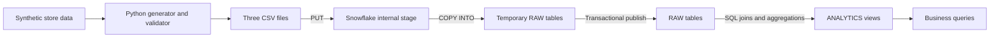

# Snowflake E-Commerce Data Warehouse

## Project Overview

A reproducible ELT pipeline for a synthetic online store. Python generates and validates customer, product, and order CSVs. The Snowflake Python Connector uploads the files to an internal stage, and Snowflake SQL loads, transforms, and analyzes the data.

## Business Problem

A store analyst needs to track monthly revenue, find best-selling products, and compare customer spending, cities, and product categories. The report must retain the price charged at the time of sale so that a catalog price change leaves historical revenue intact.

## Architecture



See [architecture details](docs/architecture.md) for transaction boundaries and failure handling.

## Technologies Used

- Python 3.13, including `csv`, `pathlib`, `decimal`, `unittest`, and `sqlite3`
- Snowflake SQL and Snowflake Connector for Python
- `python-dotenv` for local connection settings

## Dataset Description

| CSV | Data rows | Contents |
| --- | ---: | --- |
| `customers.csv` | 50 | Synthetic names and one of five Romanian cities |
| `products.csv` | 6 | Catalog names, categories, and current prices |
| `orders.csv` | 500 | Customer, product, quantity, sale price, and order date |

The generator uses seed 42. The included snapshot uses reference date `2026-11-20` and a 180-day window ending on that date. There are 556 data rows plus one header per file. Amounts are in synthetic currency units.

## Data Model

| RAW table | Grain and keys |
| --- | --- |
| `CUSTOMERS` | One row per customer, keyed by `customer_id` |
| `PRODUCTS` | One row per product, keyed by `product_id` |
| `ORDERS` | One line and one product per order, keyed by `order_id` with customer and product references |

`ANALYTICS.ORDER_DETAILS` joins those three tables at order grain and calculates `quantity * unit_price_at_sale`. Five views aggregate the result by month, product, city, customer, and category.

## Pipeline Workflow

1. Generate data or select the included CSV snapshot. Validate headers, counts, keys, relationships, dates, quantities, and monetary values locally.
2. Upload validated copies using `PUT`. Apply the named CSV file format and load session-scoped tables with `COPY INTO`.
3. Publish the three RAW tables in one transaction. Check relational integrity, compare analytics with RAW, and match warehouse revenue against the Python control total before committing.
4. Query the analytics views and print the results. The stage and temporary tables expire with the session.

The initial `run` requires empty project tables. Use `run --refresh` to explicitly replace their contents with a validated snapshot. A full refresh republishes the complete dataset. An incremental pipeline would apply only new or changed rows, typically using a stable key and `MERGE`.

## How to Run

From the repository directory in PowerShell, create the virtual environment and run the local workflow.

```powershell
py -3.13 -m venv .venv
.\.venv\Scripts\python.exe -m pip install -r requirements.txt
.\.venv\Scripts\python.exe main.py generate --reference-date 2026-11-20
.\.venv\Scripts\python.exe main.py validate
.\.venv\Scripts\python.exe -m unittest discover -s tests -v
```

`generate` replaces the three local CSV files. Omit its date option to use the current local date.

## Snowflake Setup

Use the existing `COMPUTE_WH` warehouse, database `ECOMMERCE_DB`, schemas `RAW` and `ANALYTICS`, and role `SYSADMIN`. If starting with a fresh account where the warehouse is available, run [01_setup.sql](sql/01_setup.sql) in Snowsight to create the database and schemas. Set the warehouse to X-Small for this demo if you own a fresh demo warehouse. The pipeline reuses the warehouse as configured.

1. In Snowsight, open the account selector and select **View account details**. Use the account identifier, such as the organization-and-account format, in `SNOWFLAKE_ACCOUNT`. Enter only the identifier. [Snowsight account details](https://docs.snowflake.com/en/user-guide/ui-snowsight-gs)
2. Run `SELECT CURRENT_USER();` in Snowsight and use the result as `SNOWFLAKE_USER`. If your account has a distinct login name, use the login name used to sign in.
3. Copy `.env.example` to `.env` once and fill in both values locally. Set `SNOWFLAKE_AUTHENTICATOR=OAUTH_AUTHORIZATION_CODE` in existing configurations as well. Git ignores `.env`. The connector uses the public client for the built-in `SNOWFLAKE$LOCAL_APPLICATION` integration and handles the loopback callback and PKCE. The app needs no password, OAuth token, or client secret in `.env`. This flow requires connector 3.16.0 or newer. The project pins 4.8.1. [Snowflake OAuth for local applications](https://docs.snowflake.com/en/user-guide/oauth-local-applications)
4. To check the integration's status in Snowsight, run the read-only query below with a role that can see integrations. The row for `SNOWFLAKE$LOCAL_APPLICATION` should show `enabled = true`. If the row is missing or disabled, verify visibility and status with the account administrator.

```sql
SHOW SECURITY INTEGRATIONS LIKE 'SNOWFLAKE$LOCAL_APPLICATION';
```

Run the connection check from a local PowerShell terminal. In the browser window opened by the connector, choose **Sign in with Google** when Snowflake offers it and complete the authorization. Snowflake supplies the available sign-in options for the account. [Snowflake OIDC sign-in surfaces](https://docs.snowflake.com/en/user-guide/admin-security-fed-auth-oidc#supported-sign-in-surfaces)

```powershell
if (-not (Test-Path .env)) { Copy-Item .env.example .env }
notepad .env
.\.venv\Scripts\python.exe main.py check-connection
```

Success prints `Snowflake session verified: SYSADMIN / COMPUTE_WH / ECOMMERCE_DB / RAW`. The command only reads the active session context. If the Google button is missing, confirm that the browser opened the intended Snowflake account and that Google sign-in is offered for that account and user. If session verification fails, check access to the four expected session objects.

After the connection check succeeds and you are ready to load data, use `.\.venv\Scripts\python.exe main.py run` for the initial load. Use `run --refresh` to replace existing **project** data.

### Check Data and Rerun Reports

After loading data, run the 25 warehouse quality checks and five reports against the current Snowflake data.

```powershell
.\.venv\Scripts\python.exe main.py analytics --expected-revenue 932270.00
```

The default `analytics` command only reads Snowflake. The optional `--expected-revenue` checks the total against a known control amount. Omit it to reconcile every aggregation to RAW without assuming this snapshot's total. Use `--create-missing-views` if the analytics views need to be installed. It only creates missing project views in `ECOMMERCE_DB.ANALYTICS` and preserves existing definitions.

## SQL Analytics Examples

[05_analytics_queries.sql](sql/05_analytics_queries.sql) covers five questions.

| Question | View |
| --- | --- |
| How much revenue did we earn each month? | `MONTHLY_REVENUE` |
| Which products sold the most units? | `PRODUCT_SALES` |
| Which cities contributed the most revenue? | `CITY_REVENUE` |
| Who spent the most? | `CUSTOMER_SPENDING` |
| How many orders did each category receive? | `CATEGORY_ORDERS` |

The product query uses a CTE to assign `DENSE_RANK()` to each product by units sold, then filters to ranks 1 through 3. Products tied on units share a rank, so three ranks can contain more than three products.

## Data Quality Checks

Local checks reject invalid rows before connecting. Each `COPY INTO` must load the validated count for its file. [04_data_quality_checks.sql](sql/04_data_quality_checks.sql) returns observed values, expected values, and a pass flag for counts, required fields, duplicate keys, orphan references, amount rules, joined cardinality, and aggregate reconciliation. Primary and foreign keys on standard Snowflake tables describe the relationships. The pipeline checks those relationships explicitly. [Snowflake constraints](https://docs.snowflake.com/en/sql-reference/constraints-overview)

## Testing

Run `python -m unittest discover -s tests -v` using the project environment. Tests exercise generation, byte-for-byte reproducibility, rejection of invalid data, historical pricing, and the loader's publish and rollback decisions. The SQL tests run the view and business logic against SQLite in memory with a small `DATE_TRUNC` shim and local table names. Mocked connector tests also verify that the default analytics command skips view creation and runs the quality query and reports independently of loading.

## Results

Verified in Snowflake on November 20, 2026, using the synthetic snapshot generated with reference date `2026-11-20`. The analytics run used the existing RAW data.

| Check | Result |
| --- | ---: |
| RAW customers | 50 |
| RAW products | 6 |
| RAW orders | 500 |
| Units sold | 1,285 |
| Total order revenue | 932,270.00 |
| Snowflake SQL checks passed | 25 / 25 |

Monthly, product, city, customer, and category views each reconciled to 500 orders and 932,270.00 in revenue before ranking or limiting the reports. The quality query found zero NULL rows in required fields, duplicate IDs, missing references, invalid product prices, and invalid order quantities or sale prices.

| Report | Snowflake result |
| --- | --- |
| Monthly revenue | August led with 187,220.00 from 74 orders. |
| Product sales | Mouse and Keyboard tied at rank 1 with 238 units each. Headphones ranked 2 with 216 units, followed by Webcam at rank 3 with 213 units. |
| Revenue by city | Bucharest led with 237,590.00 from 149 orders, followed by Cluj with 233,195.00 from 112 orders. |
| Customer spending | Customer_29 led with 52,190.00 from 15 orders. |
| Orders by category | Accessories led in order count. Electronics led in revenue. |

| Category | Orders | Revenue |
| --- | ---: | ---: |
| Accessories | 266 | 94,270.00 |
| Electronics | 147 | 784,000.00 |
| Audio | 87 | 54,000.00 |
| **Total** | **500** | **932,270.00** |

<details>
<summary>Complete output for the other four Snowflake reports</summary>

| Order month | Orders | Revenue |
| --- | ---: | ---: |
| 2026-05 | 16 | 84,865.00 |
| 2026-06 | 96 | 157,080.00 |
| 2026-07 | 70 | 102,540.00 |
| 2026-08 | 74 | 187,220.00 |
| 2026-09 | 87 | 180,570.00 |
| 2026-10 | 86 | 132,180.00 |
| 2026-11 | 71 | 87,815.00 |

| Sales rank | Product | Units | Revenue |
| ---: | --- | ---: | ---: |
| 1 | Mouse | 238 | 20,230.00 |
| 1 | Keyboard | 238 | 35,700.00 |
| 2 | Headphones | 216 | 54,000.00 |
| 3 | Webcam | 213 | 38,340.00 |

| City | Orders | Revenue |
| --- | ---: | ---: |
| Bucharest | 149 | 237,590.00 |
| Cluj | 112 | 233,195.00 |
| Brasov | 78 | 159,180.00 |
| Timisoara | 92 | 152,730.00 |
| Iasi | 69 | 149,575.00 |

| Customer ID | Customer | Orders | Revenue |
| ---: | --- | ---: | ---: |
| 29 | Customer_29 | 15 | 52,190.00 |
| 45 | Customer_45 | 13 | 44,405.00 |
| 28 | Customer_28 | 12 | 38,795.00 |
| 24 | Customer_24 | 18 | 36,860.00 |
| 27 | Customer_27 | 11 | 36,810.00 |

</details>

## Future Improvements

- Model orders and order lines separately for multi-product orders.
- Load new or changed rows with a watermark and `MERGE`.
- Replace the demo role with a dedicated role that has only the privileges the pipeline requires.
- Check query profiles and warehouse usage on a larger dataset before choosing optimizations.

## What I Learned

This project demonstrates how an internal stage differs from a table, why ELT transformations run inside the warehouse, and how a publish transaction keeps data and quality checks together. It also shows how to reconcile a business metric across layers and how to preserve historical prices in an order fact. See the [interview guide](docs/interview_prep.md) for examples from the code.

## Resume Summary

Built a Python and Snowflake SQL ELT pipeline for 556 synthetic e-commerce records. Implemented staged CSV loading with `PUT` and `COPY INTO`, transactional refresh, and five analytical reports. Verified 25 data-quality checks in Snowflake and reconciled all five aggregates to the RAW order totals.
